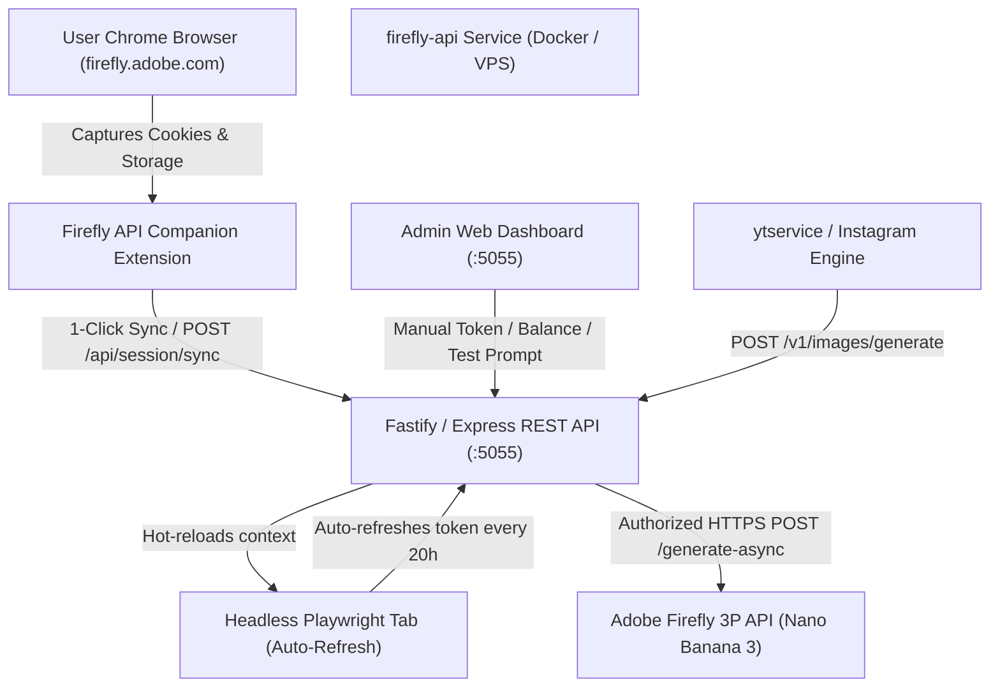

# Firefly API Architecture & Production Pipeline

## 1. Overview & Purpose
`firefly-api` is a centralized, standalone microservice and SDK designed to provide automated, watermark-free image generation powered by **Adobe Firefly 3P (Nano Banana 3 / Gemini Flash)**. It serves consumer applications (like `ytservice` for Instagram Autopilot and `anizukiBackend` for YouTube episodic productions).

---

## 2. System Architecture

---

## 3. The 3-Tier Pipeline

### Tier 1: Session Capture & Ingestion (Companion Extension)
* **Problem**: Adobe IMS tokens have a 24-hour lifetime and enforce strict Akamai/Arkose bot policies blocking raw external curl log-ins.
* **Solution**: The `Firefly API Companion` extension operates across normal and incognito windows (`"incognito": "spanning"`).
* **Scope of Capture**:
  1. Multi-domain cookies (`.adobelogin.com`, `.adobe.com`, `.services.adobe.com`, `.identity.adobe.com`).
  2. Full `localStorage` (containing `adobeid_ims_access_token/...` and device fingerprints).
  3. Active JWT access token from `window.adobeIMS.getAccessToken()`.

### Tier 2: The Core Service (`firefly-api`)
* **REST Endpoints**:
  * `POST /v1/images/generate`: Generates image via Firefly 3P with `addWatermark: false`.
  * `GET /v1/credits/balance`: Checks available/used credits.
  * `POST /api/session/sync`: Receives session updates from Extension or Dashboard.
  * `GET /health`: Returns token validity, remaining hours, and service health.
* **Headless Background Daemon**:
  * Optional autonomous Playwright instance that holds the authenticated session open in memory and evaluates `window.adobeIMS.getAccessToken()` to refresh tokens without user intervention.

### Tier 3: Consumer Integration (`ytservice`)
* Applications call `firefly-api` using either:
  * Direct HTTP call (`POST http://localhost:5055/v1/images/generate`)
  * Local Node.js Client (`import { FireflyClient } from "/Users/ayaz/tools/firefly-api"`)

---

## 4. Verification Workflow (Incognito Test)
1. In Normal Window on `https://firefly.adobe.com` (logged in):
   * Click **📥 Capture Session (Normal Tab)**.
2. In Incognito Window, open `https://firefly.adobe.com`:
   * Click **🚀 Inject & Login (Incognito Tab)**.
3. If Adobe loads in Incognito as logged in, it proves that the serialized session contains 100% of the credentials required for headless VPS operation.
